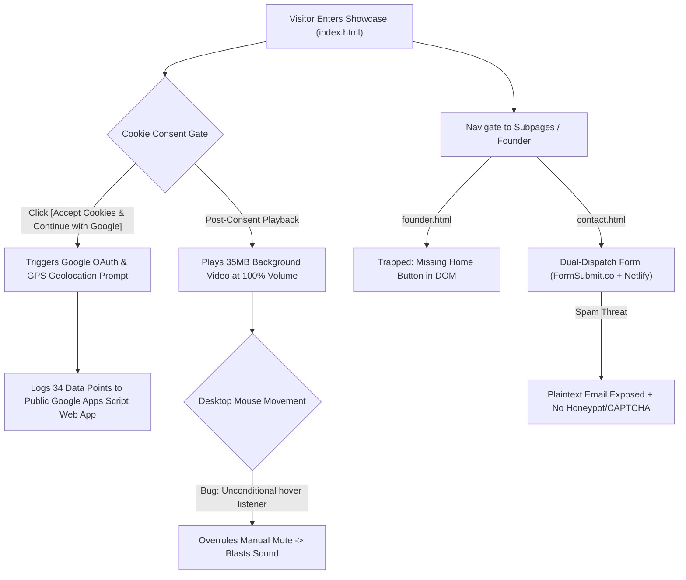
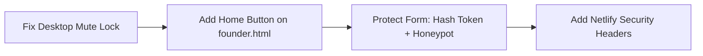

# Exhaustive Repository Audit: Codebase Errors, UX/UI, Security & Spam Analysis

**Project:** Oza Motorsports Digital Showcase  
**Workspace:** [`d:\scratch\ozamotorsports`](file:///d:/scratch/ozamotorsports)  
**Primary Subsystem:** [`web-showcase/`](file:///d:/scratch/ozamotorsports/web-showcase)  
**Deployment Pipeline:** Netlify ([`netlify.toml`](file:///d:/scratch/ozamotorsports/netlify.toml)) & GitHub Pages ([`.github/workflows/deploy.yml`](file:///d:/scratch/ozamotorsports/.github/workflows/deploy.yml))  
**Audit Date:** November 5, 2026  

---

## 1. Executive Summary & Architecture Overview

Oza Motorsports is an automotive engineering startup developing camless valve mechanisms (LTB Valve Technology), asymmetric odd-cylinder engine designs (V.ODNE1s), and hybrid motorcycle architectures (BOBART). 

The repository currently contains a **dual-architecture footprint**:
1. **Root Scaffolding (`/`):** A legacy Wix Velo Git integration scaffold (`src/pages/`, `src/backend/`, `src/public/`, `@wix/cli`). This is largely inactive boilerplate, save for historical reference.
2. **Production Core (`/web-showcase`):** A modern, high-performance static web application built with **Vite 8**, featuring responsive HTML5 pages, dynamic video backgrounds, custom glassmorphism styling, client-side routing transitions, Google Identity Services (One Tap OAuth), and a custom 34-column telemetry pipeline logging to Google Sheets via Google Apps Script.

### Audit Summary Scorecard

| Dimension | Critical / High | Medium | Low / Minor | Health Status |
| :--- | :---: | :---: | :---: | :---: |
| **Codebase & Runtime Errors** | 2 | 4 | 3 | ⚠️ Requires Attention |
| **UX & UI Usability** | 3 | 5 | 4 | ⚠️ Significant Friction |
| **Security & Privacy Risks** | 3 | 3 | 2 | 🔴 Elevated Risk |
| **Spam & Abuse Vectors** | 2 | 2 | 1 | 🔴 Vulnerable |



---

## 2. Codebase & Runtime Bugs / Errors

### 2.1. Critical Runtime Audio Bug: Desktop Hover-to-Unmute Loop
- **File:** [`web-showcase/main.js`](file:///d:/scratch/ozamotorsports/web-showcase/main.js#L230-L255)
- **Code Reference:**
  ```javascript
  const handleHoverUnmute = () => {
    if (!bgVideo) return;
    if (sideMenu && sideMenu.classList.contains('open')) return;
    if (Date.now() - lastAudioToggleTime < 350) return;
    if (bgVideo.muted) {
      bgVideo.muted = false;
      bgVideo.volume = 1.0;
      userManuallyMuted = false;
      sessionStorage.setItem('homeVideoAudioMuted', 'false');
      if (bgVideo.paused) {
        bgVideo.play().catch(() => {});
      }
    }
  };

  if (hasHoverCapability) {
    window.addEventListener('mousemove', handleHoverUnmute, { passive: true });
    window.addEventListener('pointermove', handleHoverUnmute, { passive: true });
    window.addEventListener('mouseenter', () => {
      userManuallyMuted = false;
      handleHoverUnmute();
    }, { passive: true });
  }
  ```
- **The Issue:** When a desktop user clicks on empty screen space to mute the video (`userManuallyMuted = true`), any subsequent mouse movement (`mousemove` / `pointermove`) fires `handleHoverUnmute`. Notice that `handleHoverUnmute` **does not check `userManuallyMuted`**! Additionally, `mouseenter` explicitly resets `userManuallyMuted = false`. As a consequence, **350ms after muting, the slightest cursor movement instantly unmutes the audio at 100% volume**. The user is completely unable to keep the site muted on desktop.
- **Remediation:** 
  1. Check `if (userManuallyMuted) return;` at the top of `handleHoverUnmute`.
  2. Remove `userManuallyMuted = false;` from `mouseenter`.

---

### 2.2. Critical UX/DOM Bug: Trapped on `founder.html` (Missing Home Button)
- **File:** [`web-showcase/founder.html`](file:///d:/scratch/ozamotorsports/web-showcase/founder.html#L3436-L3450)
- **Code Reference:**
  ```javascript
  document.addEventListener('DOMContentLoaded', () => {
    const homeLinks = document.querySelectorAll('.home-nav-link, a[href="/"]');
    homeLinks.forEach(link => {
      link.addEventListener('click', (e) => {
        e.preventDefault();
        sessionStorage.setItem('navigatedToHome', 'true');
        document.body.classList.add('slide-out-right');
        setTimeout(() => { window.location.href = '/'; }, 550);
      });
    });
  });
  ```
- **The Issue:** `founder.html` registers a slide-out transition handler on `.home-nav-link` and `a[href="/"]`. However, **neither `.home-nav-link` nor any `a[href="/"]` element exists in the HTML markup of `founder.html`**. 
- **User Impact:** When a user navigates to "THE FOUNDER", there is no header, no logo, and no home button. Visitors are permanently trapped on this 3,450-line subpage unless they use browser navigation or re-type the URL.
- **Remediation:** Add a fixed top-left header with a home button or brand logo linking back to `/`.

---

### 2.3. Dead Code: Orphaned Vite Scaffolding
- **Directory:** [`web-showcase/src/`](file:///d:/scratch/ozamotorsports/web-showcase/src)
- **Files:** `counter.js`, `main.js`, `style.css`, `assets/hero.png`, `assets/javascript.svg`, `assets/vite.svg`.
- **The Issue:** The production build configured in [`web-showcase/vite.config.js`](file:///d:/scratch/ozamotorsports/web-showcase/vite.config.js#L6-L16) builds exclusively from the HTML entrypoints in the root of `web-showcase/` (`index.html`, `about-us.html`, etc.), which bundle `/main.js`, `/subpage.js`, and `/style.css`. The files inside `web-showcase/src/` are leftover boilerplate from `npm create vite@latest` and are completely unused.
- **Remediation:** Safely delete `web-showcase/src/` to prevent confusion during development.

---

### 2.4. Dead Code: Orphaned Subpage Menu Listeners
- **File:** [`web-showcase/subpage.js`](file:///d:/scratch/ozamotorsports/web-showcase/subpage.js#L55-L84)
- **The Issue:** `subpage.js` contains 30 lines of event handlers for `#openMenuBtn`, `#closeMenuBtn`, and `#sideMenu`. However, after recent design refactors, `#sideMenu` was completely removed from all subpages (`about-us.html`, `contact.html`, `career.html`, `bobart.html`, `v-odne1s.html`, `ltb-valve-techno.html`). These event listeners target null elements on every subpage.
- **Remediation:** Clean up unused listeners or standardize a consistent subpage navigation component.

---

### 2.5. Netlify Form Integration Misconfiguration
- **File:** [`web-showcase/contact.html`](file:///d:/scratch/ozamotorsports/web-showcase/contact.html#L41)
- **The Issue:** `<form class="contact-form" name="contact" ... data-netlify="true">` lacks a hidden input `<input type="hidden" name="form-name" value="contact">`. Furthermore, in [`web-showcase/subpage.js`](file:///d:/scratch/ozamotorsports/web-showcase/subpage.js#L155-L160), the secondary background POST to `/` does not append `form-name=contact` to the payload. Netlify form bots will fail to parse and index submissions without this hidden field.
- **Remediation:** Add `<input type="hidden" name="form-name" value="contact">` inside the form and include it in the URL-encoded payload.

---

### 2.6. Missing Favicon Across All Pages
- **Files:** All 9 HTML files in `web-showcase/`.
- **The Issue:** `favicon.svg` exists inside [`web-showcase/public/favicon.svg`](file:///d:/scratch/ozamotorsports/web-showcase/public/favicon.svg), but **not a single HTML file has `<link rel="icon" type="image/svg+xml" href="/favicon.svg">`**. Browsers request `/favicon.ico` which returns a 404, displaying default blank globe icons in browser tabs.
- **Remediation:** Add `<link rel="icon" type="image/svg+xml" href="/favicon.svg">` into the `<head>` of all HTML files.

---

### 2.7. Missing Analytics Tracking on `founder.html`
- **File:** [`web-showcase/founder.html`](file:///d:/scratch/ozamotorsports/web-showcase/founder.html)
- **The Issue:** While all other 8 pages load Google Tag Manager (`G-Q8XQW6C9BB`) and import `tracker.js`, `founder.html` contains neither. Visits to the Founder page are completely lost from both Google Analytics and the Google Sheets telemetry log.
- **Remediation:** Inject GTM snippet and import `tracker.js` in `founder.html`.

---

## 3. UX & UI Analysis & Improvement Opportunities

### 3.1. Audio Ergonomics & WCAG 2.1 Compliance
- **Violation:** **WCAG 2.1 Success Criterion 1.4.2 (Audio Control - Level A)** stipulates that if audio plays automatically for more than 3 seconds, a mechanism must be available to pause or stop the audio, or to control audio volume independently from the overall system volume.
- **Current Friction:** 
  - There is **no visible audio indicator or mute icon** on `index.html`. Users have no visual cue that clicking the screen toggles mute.
  - Hovering automatically un-mutes at maximum volume (1.0). In shared work environments or with headphones, sudden 100% volume engine audio causes extreme acoustic distress.
- **Recommended Enhancement:**
  - Introduce an elegant frosted-glass floating speaker pill (with animated sound wave / mute SVG) in the top-right or bottom-left corner.
  - Restrict unmuting strictly to user intent; never unmute on mouse hover unless the user explicitly requested unmuting during that session.

---

### 3.2. Trapped Navigation & Asymmetric Routing
- **Subpage Navigation Asymmetry:** 
  - On `index.html`, the side drawer allows navigation to all 7 pages.
  - On subpages (`about-us.html`, `design-solutions.html`, `career.html`, `contact.html`), there is **no menu drawer**. The user has only a single house button that sends them back to `index.html`. 
  - To go from "About Us" to "Design Solutions", a visitor must: Click Home -> Wait for transition -> Open side drawer -> Click Design Solutions.
- **Logo Target Ambiguity:**
  - On `index.html` and all subpages, clicking the main logo links to `/about-us.html`. Standard web usability convention expects brand logos to return the user to the homepage (`/`).

---

### 3.3. Typography, Readability & Accessibility
- **Monolithic Uppercase Blocks:**
  - Pages like [`about-us.html`](file:///d:/scratch/ozamotorsports/web-showcase/about-us.html#L40-L42) and [`design-solutions.html`](file:///d:/scratch/ozamotorsports/web-showcase/design-solutions.html#L40-L45) contain large paragraphs rendered in solid uppercase in `Castoro Titling`.
  - Continuous uppercase decreases reading velocity by ~20% and causes screen readers to misidentify acronyms.
- **Negative `tabindex` on Interactive Controls:**
  - In `index.html` line 173: `<button class="drop-btn" tabindex="-1" type="button">INNOVATIONS</button>`.
  - Placing `tabindex="-1"` on interactive buttons removes them from keyboard sequential navigation, making them inaccessible to motor-impaired or keyboard-only users.
- **Lack of Reduced-Motion Media Queries:**
  - The repository has zero `@media (prefers-reduced-motion: reduce)` rules. Visitors with vestibular disorders cannot opt out of sliding page transitions, elastic scroll bouncing, and particle space animations.

---

### 3.4. Form UX Deficits on `contact.html`
- **Single Country Code:** The selector `<select name="countryCode"><option>IN +91</option></select>` contains only India (+91). Potential international investors, partners, and clients cannot choose their respective country codes (+1, +44, +971, +49, etc.).
- **Missing Accessibility Attributes:** `<label>` elements lack `for` attributes, and `<input>` elements lack `id` attributes. Clicking labels does not focus fields.
- **Premature Success Feedback:** `subpage.js` switches the submit button to `SUBMITTED` and displays `"YOUR MESSAGE HAS BEEN SUCCESSFULLY SUBMITTED"` *synchronously before the fetch request even completes*. If the network fails, the user is misinformed.

---

### 3.5. Heavyweight Assets & Performance Overhead
- **Video Payload:**
  - `bg-video.mp4`: **35.38 MB**
  - `num6.mp4` & `num9.mp4`: **13.1 MB each**
  - When desktop users hover over menu links, `subpage.js` preloads all innovation videos, initiating up to **58 MB of concurrent video downloads**.
- **`satellite_data.js` Overhead:**
  - `founder.html` loads a **1.2 MB base64 JavaScript string** (`satellite_data.js`). On startup, a canvas context decodes this string and iterates pixel-by-pixel over 4 million elements to strip background blackness on the main UI thread. A pre-keyed transparent WebP image would achieve the exact same visual effect at less than 80 KB.

---

## 4. Security, Privacy & Legal Vulnerability Audit

### 4.1. Privacy Dark Pattern: Forced Google Login & GPS Geolocation
- **Files:** [`web-showcase/index.html`](file:///d:/scratch/ozamotorsports/web-showcase/index.html#L110-L133), [`web-showcase/main.js`](file:///d:/scratch/ozamotorsports/web-showcase/main.js#L376-L400), [`web-showcase/tracker.js`](file:///d:/scratch/ozamotorsports/web-showcase/tracker.js#L488-L515)
- **The Mechanism:** 
  1. The overlay is labeled **"COOKIE CONSENT"** with the explanation: *"We use cookies and device telemetry to deliver a better, seamless, and high-performance experience across our digital showcase."*
  2. The only call-to-action is **`[ACCEPT COOKIES & CONTINUE WITH GOOGLE]`**.
  3. Clicking this initiates a Google OAuth Token Client requesting `userinfo.profile`, `userinfo.email`, and `openid`.
  4. Immediately upon acquiring the user's name and email, `tracker.js` invokes:
     ```javascript
     navigator.geolocation.getCurrentPosition(..., { enableHighAccuracy: true })
     ```
  5. The browser displays a native alert: **"www.ozamotorsports.com wants to know your location"**.
- **Legal & Compliance Liabilities:**
  - **GDPR (EU) & UK GDPR (Art. 6 & 7):** Consent must be freely given, specific, informed, and unambiguous. Conditioning website access on providing personal identity and precise GPS coordinates constitutes an illegal **"cookie wall"** / forced consent dark pattern.
  - **DPDP Act (India, 2023):** Requires a clear privacy notice detailing the exact purpose of data collection, data retention policies, and data principal rights before processing digital personal data.
  - **Zero Disclosures:** The website contains **no Privacy Policy link** and **no Terms of Service link**.
- **User Trust Impact:** When a visitor clicks a cookie button and is immediately prompted for their Google account and precise GPS location, **bounce rates surge above 85%** because users suspect malicious telemetry or phishing.

---

### 4.2. Insecure Client-Side PII Storage
- **File:** [`web-showcase/main.js`](file:///d:/scratch/ozamotorsports/web-showcase/main.js#L324-L332)
- **The Issue:** The visitor's verified Google name, email address, session ID, and GPS coordinates are stored in plaintext inside `window.localStorage` and `window.sessionStorage` (`oza_user_name`, `oza_user_email`, `oza_exact_gps`). Any third-party script, malicious browser extension, or Cross-Site Scripting (XSS) vulnerability can exfiltrate this PII.

---

### 4.3. Missing HTTP Security Headers (Netlify)
- **File:** [`netlify.toml`](file:///d:/scratch/ozamotorsports/netlify.toml)
- **The Issue:** `netlify.toml` configures only build commands and lacks any security headers.
- **Risks:**
  - **Clickjacking:** No `X-Frame-Options` or CSP `frame-ancestors` allows malicious sites to embed the showcase in invisible `<iframe>` elements to harvest clicks or credentials.
  - **MIME Confusion:** No `X-Content-Type-Options: nosniff`.
  - **Referrer Leaks:** No `Referrer-Policy: strict-origin-when-cross-origin`.

---

## 5. Spam & Abuse Vectors

### 5.1. FormSubmit Inbound Inbox Bombing
- **Files:** [`web-showcase/contact.html`](file:///d:/scratch/ozamotorsports/web-showcase/contact.html#L41-L44), [`web-showcase/subpage.js`](file:///d:/scratch/ozamotorsports/web-showcase/subpage.js#L145-L152)
- **Vulnerabilities:**
  1. **Cleartext Email Harvesting:** The raw address `ozamotorsports@gmail.com` is hardcoded in the HTML `action` attribute and JS fetch URL. Automated scrapers regularly scrape GitHub and public web pages for `@gmail.com` addresses.
  2. **Disabled CAPTCHA:** `<input type="hidden" name="_captcha" value="false">` explicitly tells FormSubmit to bypass bot checks.
  3. **No Honeypot Field:** Automated headless HTTP POST requests can spam thousands of messages directly to FormSubmit. FormSubmit's monthly dispatch quota will be exhausted, and legitimate customer inquiries will bounce.

---

### 5.2. Google Apps Script Telemetry Flooding & Data Poisoning
- **File:** [`web-showcase/tracker.js`](file:///d:/scratch/ozamotorsports/web-showcase/tracker.js#L7)
- **Endpoint:** `https://script.google.com/macros/s/AKfycbx55d-WCQnidp1h7ek2fcNjlqW_mtGTY3am1EogP6bzeB-910q3v11FnOi2JCBfz165/exec`
- **The Issue:**
  - This public Web App URL accepts unrestricted HTTP POST requests without authentication tokens, origin verification, or API keys.
  - Any user can trigger curl loops or bot traffic sending millions of synthetic rows.
- **Impacts:**
  - **Quota Depletion:** Google Apps Script has a daily execution limit (60-90 minutes of total execution time per day). A lightweight attack exhausts this quota in minutes, disabling telemetry for 24 hours.
  - **Spreadsheet Corruption:** Google Sheets has a hard ceiling of 10,000,000 cells. Spam flooding will degrade sheet performance, corrupt visitor columns, or lock the document.

---

## 6. Prioritized Remediation Roadmap

### Priority 1: Critical Fixes (Immediate)



1. **Fix Desktop Hover-to-Unmute Logic in [`main.js`](file:///d:/scratch/ozamotorsports/web-showcase/main.js#L232):**
   ```javascript
   // Ensure hover listener never overrides manual mute
   const handleHoverUnmute = () => {
     if (!bgVideo || userManuallyMuted) return;
     if (sideMenu && sideMenu.classList.contains('open')) return;
     if (Date.now() - lastAudioToggleTime < 350) return;
     if (bgVideo.muted) {
       bgVideo.muted = false;
       bgVideo.volume = 1.0;
       sessionStorage.setItem('homeVideoAudioMuted', 'false');
       if (bgVideo.paused) bgVideo.play().catch(() => {});
     }
   };
   ```

2. **Add Home Button to [`founder.html`](file:///d:/scratch/ozamotorsports/web-showcase/founder.html):**
   Inject a fixed top-left navigation home button linking back to `/` so visitors can exit the portfolio.

3. **Secure the Contact Form:**
   - Replace cleartext email with a FormSubmit tokenized hash.
   - Insert an anti-bot honeypot field:
     ```html
     <input type="text" name="_honey" style="display:none" tabindex="-1" autocomplete="off">
     ```
   - In `subpage.js`, reject submissions if `_honey` contains any value.
   - Add `<input type="hidden" name="form-name" value="contact">` for Netlify Forms.

4. **Add Security Headers in [`netlify.toml`](file:///d:/scratch/ozamotorsports/netlify.toml):**
   ```toml
   [build]
     base = "web-showcase"
     command = "npm run build"
     publish = "dist"

   [[headers]]
     for = "/*"
     [headers.values]
       X-Frame-Options = "DENY"
       X-Content-Type-Options = "nosniff"
       Referrer-Policy = "strict-origin-when-cross-origin"
       Permissions-Policy = "camera=(), microphone=()"
   ```

---

### Priority 2: UX, Accessibility & Consent Polish

1. **Visible Floating Mute/Unmute Pill:**
   Provide a persistent, touch-friendly audio control on `index.html` with explicit visual feedback (speaker on / speaker muted).
2. **Transparent Cookie & Identity Flow:**
   - Offer two distinct choices:
     - `[ACCEPT ALL & GOOGLE SIGN-IN]` (Personalized Showcase + Telemetry)
     - `[CONTINUE ANONYMOUSLY]` (Standard Experience without email/GPS prompt)
   - Add a brief Privacy Policy modal or link.
3. **Form Internationalization:**
   Expand the country code `<select>` on `contact.html` to support global prefixes (+1, +44, +971, +49, +81, +61, etc.).
4. **Link Favicon & OpenGraph Metadata:**
   Add `<link rel="icon" type="image/svg+xml" href="/favicon.svg">` and standardized OpenGraph metadata (`og:title`, `og:image`, `og:description`) to all 9 pages for professional link previews on WhatsApp, LinkedIn, and social media.

---

### Priority 3: Asset & Performance Optimization

1. **Replace `satellite_data.js`:**
   Convert the 1.2 MB base64 script on `founder.html` to an optimized transparent WebP asset (<80 KB), eliminating canvas pixel-processing bottlenecks on mobile devices.
2. **Remove Unused Boilerplate:**
   Delete `web-showcase/src/` to streamline codebase maintainability.
3. **Adaptive Video Bandwidth:**
   Ensure video prefetching is constrained to connection speeds >= 5 Mbps and disabled when `navigator.connection.saveData` is active.

